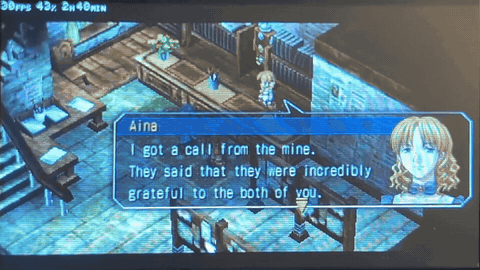
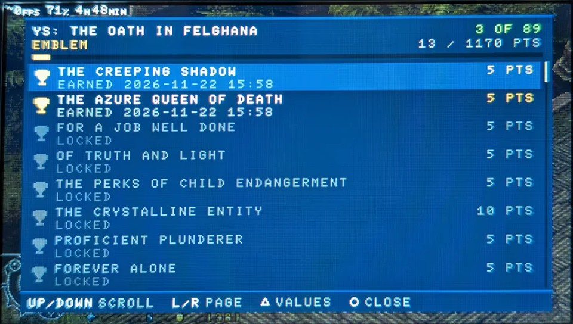
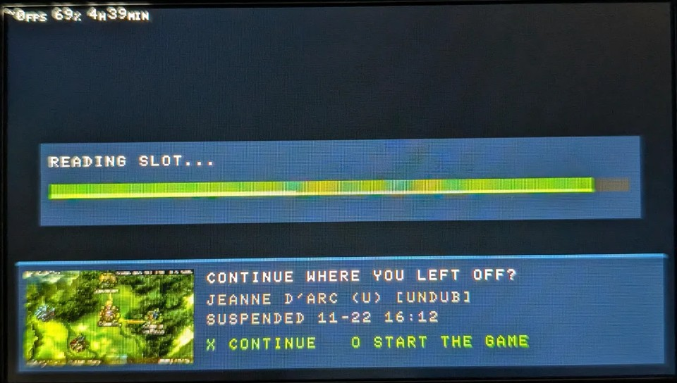
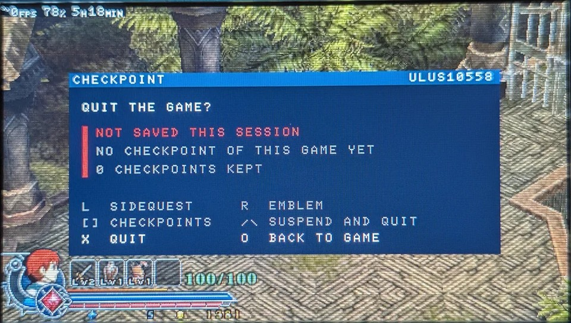
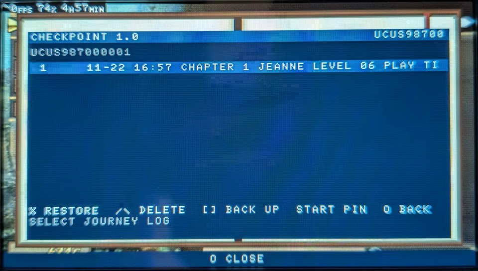
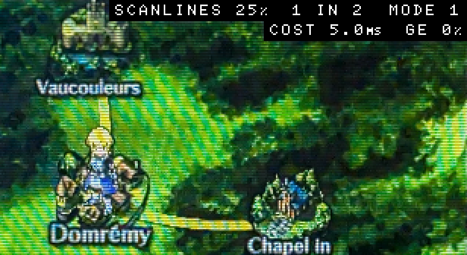
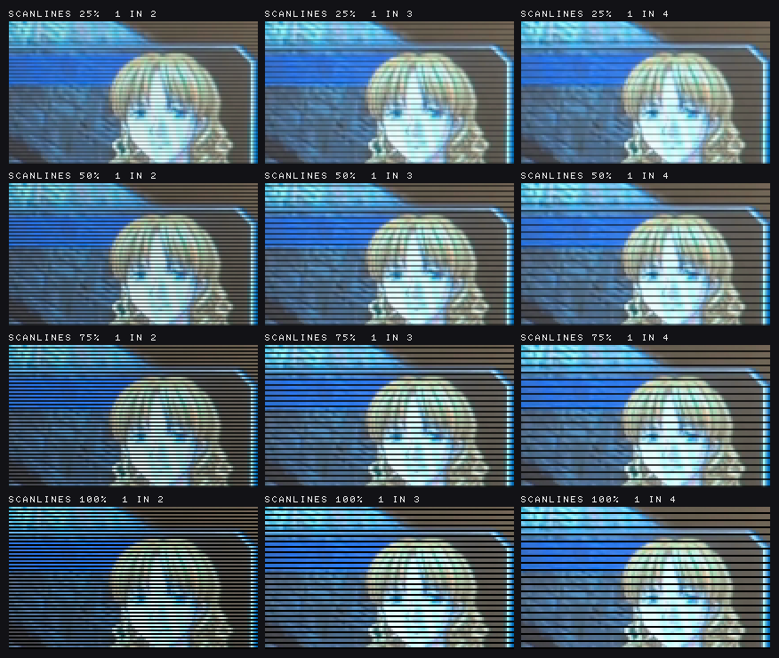

# PSP ARK Plugins

Kernel plugins for the PSP on ARK-5 custom firmware: **Emblem**, **Sidequest**, **Checkpoint**, **Scanline** and **Runtime**.

**On a PS Vita, use [psvita-ark-plugins](https://github.com/00KAM1/psvita-ark-plugins).** Those are the same plugins built for ARK-5 inside [Adrenaline 8](https://github.com/isage/Adrenaline), changed where the Vita needed it. The builds here are for a real PSP and are not meant for a Vita. The Vita's launcher is [psvita-shelf-launcher](https://github.com/00KAM1/psvita-shelf-launcher).

Emblem, Sidequest, Checkpoint and Scanline each work on their own. They are independent of each other, so you can install any of them, and they are made to run side by side. **Runtime is the exception:** it is built for the [Shelf launcher](https://github.com/00KAM1/psp-shelf-launcher) and shows nothing without it.

**Shelf** is a home screen and game launcher that brings these plugins together: it shows each game's save states, journey and achievements in one place. It has its own repository, [psp-shelf-launcher](https://github.com/00KAM1/psp-shelf-launcher). The plugins do not need Shelf, and Shelf runs without them.

**Shelf Tools** is a web page that goes with them: **Recap** shows your play for a year, a month or all time from what the plugins have kept on the Memory Stick, and the **Emblem Workshop** writes and checks Emblem's game files. It runs in your browser and has its own repository, [psp-shelf-tools](https://github.com/00KAM1/psp-shelf-tools). Open it at [00kam1.github.io/psp-shelf-tools](https://00kam1.github.io/psp-shelf-tools/).

| Plugin | Version | What it does | Opens with |
|---|---|---|---|
| [**Emblem**](#emblem) | 1.2 | Achievements, earned and kept on the Memory Stick. One text file per game. | Hold **L + R + LEFT**, ½ s |
| [**Sidequest**](#sidequest) | 1.3 | Save states. Freezes the whole system and brings it back later: one suspend slot and five state slots for every game. | Hold **SELECT** alone, 1 s |
| [**Checkpoint**](#checkpoint) | 1.2 | A dated history of your game saves, a journey log that writes itself, and a PS-button quit screen that shows when you last saved. | **L + R + SELECT**, PS button |
| [**Scanline**](#scanline) | 1.2 | CRT-style scanlines over any game, with settings kept per game. | Hold **L + R** with a button, ½ s |
| [**Runtime**](#runtime) | 1.0 | Counts time on and battery use for the [Shelf launcher](https://github.com/00KAM1/psp-shelf-launcher). **Needs Shelf: it shows nothing by itself.** | No buttons |

Each plugin has its own version number, which goes up only when that plugin's files change. All of them come in one release file, and the [changelog](CHANGELOG.md) says which ones to replace when you update.

> **Disclosure.** These plugins were written by Claude, Anthropic’s AI model, from my ideas and my testing on a PSP-3000. I’m not a kernel programmer, and nothing has been tested beyond my own console. Please read the known issues ([Emblem](docs/emblem-known-issues.md), [Sidequest + Checkpoint](docs/sidequest-checkpoint-known-issues.md), [Scanline](docs/scanline-known-issues.md), [Runtime](docs/runtime.md)) before relying on them.

## Emblem

Achievements for PSP games, kept on the Memory Stick. Emblem watches a game's memory while you play and pops up a card when an achievement is earned. Nothing goes online.

<p align="center">
  
  
</p>

- **One text file per game.** The plugin knows no games itself; a game without a file is left alone.
- **Write your own game file** in the [Emblem Workshop](https://00kam1.github.io/psp-shelf-tools/), a web page that checks the file with the plugin's own rule engine.
- **41 games, 1,731 achievements in this release**, every file written or checked by hand with AI assistance. Most files cover part of a game's set, and only Ys: The Oath in Felghana and Trails in the Sky have been played on a PSP so far; see the [manual](docs/emblem.md#games) for the list.
- Hold L + R + LEFT for half a second to see every achievement of the game, earned or locked.
- Loading a save that is already far in catches up at once.

Achievement titles and points come from the [RetroAchievements](https://retroachievements.org) sets, and the memory addresses from their public code notes. Emblem is not connected to RetroAchievements, and nothing earned here appears on a RetroAchievements account.

**Requirements:** PSP-3000 on ARK-5. PSP games only. Your copy has to be the release a game file was made for.

**Documentation:** [Manual](docs/emblem.md) · [Adding a game](docs/emblem-adding-games.md) · [Known issues and test status](docs/emblem-known-issues.md) · [How it works](docs/emblem-how-it-works.md)

## Sidequest

Save states for PSP games. Sidequest freezes the whole system exactly as it is and brings it back later. Every game has six slots of its own: a suspend slot and five states, each with a picture.

<p align="center">
  
  
</p>

- Hold SELECT on its own for one second to open the menu. X saves, □ loads, △ deletes.
- L / R looks at other games' slots, and loading one switches games.
- Starting a game that has a slot offers to continue from the newest one.
- The PSP sleeps for a few seconds for each save and load, and wakes itself.
- With the [Shelf launcher](https://github.com/00KAM1/psp-shelf-launcher), a game started from Shelf's Home tab goes straight back to its newest slot without the question.

> [!WARNING]
> **Due to limitations in the way save states are saved and restored, a state is only safe to load on the setup it was made on. Delete your old states before you install or update anything.**
>
> A Sidequest state is a copy of the whole running system at that moment: the game, the launcher, and every plugin in the version that was installed then. Loading it brings all of that back. This is the same whether you load from Sidequest's menu or resume a game from the [Shelf launcher](https://github.com/00KAM1/psp-shelf-launcher)'s Home tab.
>
> A state made **before** you installed or updated Shelf, Sidequest, any other plugin, or ARK no longer matches what is on the Memory Stick. Loading one can:
>
> - end in a **black screen** instead of the launcher when you quit the game;
> - run the **old versions** of the plugins, or run without a plugin you have added since, until the game is restarted;
> - leave **files on the Memory Stick damaged**. On my PSP, Shelf's saved game list and logs were damaged after loading such a state.
>
> **Every time you install or update:**
>
> 1. Save in each game the normal way, from the game's own save menu.
> 2. Delete every state. △ in Sidequest's menu deletes the selected slot, the suspend included, and L / R there shows your other games' slots. With a computer, deleting the game folders inside `ms0:/SIDEQUEST/` (keeping `config.txt`) does the same in one go.
> 3. Install the new files, then take new states.
>
> If a load ends in a black screen, hold POWER up for ten seconds to switch off. More in the [manual](docs/sidequest.md#things-to-know).

**If that risk is more than you want, leave Sidequest out.** Nothing else here needs it. Emblem, Checkpoint, Scanline and Runtime work exactly the same without it, and so does the [Shelf launcher](https://github.com/00KAM1/psp-shelf-launcher). To leave it out, do not copy `sidequest.prx` or its line in `PLUGINS.TXT`. What you give up is save states, "Suspend and quit" on Checkpoint's quit screen (its Sidequest buttons are simply not shown), and resuming a game from Shelf's Home tab. Your games' own saves, and Checkpoint's copies of them, are not save states and are not affected by any of this.

**Requirements:** PSP-3000 on firmware **6.61** (the PSP-2000 has the same memory and may work but is untested; not the 1000, Go or Street). Sidequest checks the PSP's flash driver and refuses to save if it is not the one it knows. ARK-5 with **Extra RAM** set to `Off`. Games started from an ISO/CSO or a PSN `EBOOT.PBP`; real UMD discs are refused. A slot takes about 5MB to 27MB of Memory Stick space.

**Documentation:** [Manual](docs/sidequest.md) · [Known issues and test status](docs/sidequest-checkpoint-known-issues.md) · [How it works](docs/sidequest-checkpoint-how-it-works.md)

## Checkpoint

A history of your game saves. Checkpoint keeps a dated copy every time a game saves, so an earlier version can be put back. It also keeps a journey log, a diary of the playthrough that writes itself, and replaces the PS-button quit screen with one that shows when you last saved.

<p align="center">
  
  
  
</p>

- L + R + SELECT opens the menu: pick a save, pick a version, restore it. START pins a version so it is never pushed out.
- SELECT in the menu opens the journey log.
- The PS button opens the quit screen. From there, L opens Sidequest's menu, R opens Emblem's viewer, and △ is **suspend and quit**: the game is frozen into Sidequest's suspend slot and closed, and offers to continue from that moment the next time you start it.

**Requirements:** PSP-3000 on ARK-5. PSP games only, not PS1 games. Checkpoint uses up to ten times the size of each save (most saves are under 1MB).

**Documentation:** [Manual](docs/checkpoint.md) · [Known issues and test status](docs/sidequest-checkpoint-known-issues.md) · [How it works](docs/sidequest-checkpoint-how-it-works.md)

## Scanline

CRT-style scanlines over any game, with the settings you choose remembered for each game.

<p align="center">
  
  
</p>

- Seven strengths from 12.5% to 100%, with lines on every 2nd, 3rd or 4th row.
- Changed from inside the game with L + R and one button. No menu.
- **Each game keeps its own settings**, including whether scanlines are on at all.
- Two modes per game: mode 1 (the default) for almost every game, mode 2 for a game whose top rows flicker.
- Costs about 3 ms a frame in a 16-bit game on a PSP-3000.

This is a new plugin written from scratch. It is not based on, and shares no code with, the older ScanLine 0.1 plugin by Omega2058.

**Requirements:** PSP-3000 on ARK-5. Other PSP models are untested, and PS1 games have not been tried.

**Documentation:** [Manual](docs/scanline.md) · [Known issues and test status](docs/scanline-known-issues.md) · [How it works](docs/scanline-how-it-works.md)

## Runtime

A companion to the [Shelf launcher](https://github.com/00KAM1/psp-shelf-launcher). **It does nothing you can see on its own:** it has no screen, buttons or menu. It keeps count of how long the PSP has been on, and of the battery used, in every program, and Shelf's PS-button menu shows the numbers. Install it only if you use Shelf.

- Counts in the XMB, in games and in the launcher, with sleep counted apart.
- Writes its record into its own folder, `ms0:/RUNTIME/`, which Shelf reads.
- It has run on a PSP-3000 with Shelf. The individual checks are listed in its notes.

**Requirements:** PSP-3000 on ARK-5, and Shelf to show the numbers.

**Documentation:** [Notes, install and test status](docs/runtime.md)

*The pictures on this page are photos and a video of a PSP-3000 screen. The two Scanline pictures are a photo and a video frame rebuilt at the PSP's own pixel size, with the lines drawn by the plugin's code.*

## Install

Download the newest `psp-ark-plugins` zip from the [Releases](../../releases) page and unpack it. Install all of them, or only the ones you want. Runtime is only for use with the [Shelf launcher](https://github.com/00KAM1/psp-shelf-launcher).

1. Copy the `.prx` files you want from `SEPLUGINS` to `ms0:/SEPLUGINS/`.
2. Copy the matching folders (`SIDEQUEST`, `CHECKPOINT`, `SCANLINE`, `EMBLEM`) to the root of the Memory Stick. `EMBLEM` holds the game files, so Emblem needs it. The other three hold settings and are made by the plugins if missing.
3. Add a line to `ms0:/SEPLUGINS/PLUGINS.TXT` for each plugin you installed:
   ```
   game, ms0:/SEPLUGINS/sidequest.prx, on
   game, ms0:/SEPLUGINS/checkpoint.prx, on
   game, ms0:/SEPLUGINS/scanline.prx, on
   game, ms0:/SEPLUGINS/emblem.prx, on
   always, ms0:/SEPLUGINS/runtime.prx, on
   ```
   Runtime's line says `always` because it also has to run outside games.
4. Restart the PSP.

**Updating:** copy over the `.prx` and the `config.txt` of the plugins whose version went up; the [changelog](CHANGELOG.md) lists them. For this release that is all four of `sidequest.prx`, `checkpoint.prx`, `emblem.prx` and `scanline.prx`, with no settings file. Coming from Sidequest 1.0, also replace `SIDEQUEST/config.txt`. Delete your states before any update and take new ones.

## Buttons at a glance

None of the four uses another's buttons, and all leave MissyHUD's L + R + START alone.

Some of these can be changed in the plugin's `config.txt`:

- **Sidequest** and **Checkpoint**: `hotkey` sets the button or combination that opens the menu, and `hold_ms` how long it is held.
- **Scanline**: the combinations are fixed. `hotkeys = 0` turns them off, and the settings are then taken from its files.
- **Emblem**: fixed; it has no settings file.
- The buttons inside the menus and on the quit screen are fixed.

| Where | Button | Action |
|---|---|---|
| In a game | Hold SELECT alone, 1 s | Sidequest menu |
| In a game | L + R + SELECT | Checkpoint menu |
| In a game | PS button | Checkpoint's quit screen |
| In a game | Hold L + R + LEFT, ½ s | Emblem's achievement viewer |
| In a game | Hold L + R + △, ½ s | Scanlines on / off for this game |
| In a game | Hold L + R + UP / DOWN, ½ s | Darker / lighter scanlines |
| In a game | Hold L + R + O, ½ s | Scanline spacing: 1 in 2, 3 or 4 rows |
| In a game | Hold L + R + □, ½ s | Scanline mode 1 / mode 2 |
| Sidequest menu | X / □ / △ | Save state / load / delete |
| Sidequest menu | L / R | Look at another game's slots |
| Checkpoint menu | X / □ / △ / START | Open or restore / back up now / delete / pin |
| Checkpoint menu | SELECT | Journey log (L / R turn the page) |
| Quit screen | X / O | Quit / back to game |
| Quit screen | □ / △ | Checkpoints / suspend and quit |
| Quit screen | L / R | Sidequest menu / Emblem viewer |
| Emblem viewer | UP / DOWN, L / R, △ | Scroll, page, values page |

## If something goes wrong

- **Screen stays dark after a Sidequest save or load:** slide the POWER switch up. The save or load then finishes; nothing is lost.
- **A game's own save or load screen opens blank and stays stuck:** fixed in Sidequest 1.3, Checkpoint 1.2, Emblem 1.2 and Scanline 1.2 (the PSP was short of kernel memory). If it still happens, switch one plugin off and send `checkpoint.log`: its `memory free` lines show how much was left.
- **Text missing after a Sidequest load:** fixed in Sidequest 1.1. If it still happens, power off fully and send `sidequest.log`.
- **Top rows or Scanline's label flicker in one game:** hold L + R + □ to try Scanline's mode 2 in that game.
- **An achievement pops when it should not:** delete its line from the game's file in `ms0:/EMBLEM/games/`, and from `ms0:/EMBLEM/earned/`.
- **PSP frozen:** hold the POWER switch up for 10 seconds to switch it off.
- **Turn a plugin off:** set its line in `PLUGINS.TXT` to `off`, or use ARK-5's plugin manager. Sidequest, Checkpoint and Emblem do not load in the XMB or in ARK's launcher, so those always stay usable. Scanlines can be turned off for a single game with L + R + △.
- **Logs:** `sidequest.log`, `checkpoint.log`, `scanline.log` and `emblem.log`, each in its plugin's folder on the Memory Stick. The first line of each run names the build (`built <date> <time>`); include it in any bug report.

## Repository layout

```
sidequest/    Sidequest source and tests
checkpoint/   Checkpoint source and tests
scanline/     Scanline source and tests
emblem/       Emblem source and tests, and the game files in emblem/games/
runtime/      Runtime source and tests (companion to the Shelf launcher)
docs/         manuals, known issues and technical notes for each plugin; pictures in docs/images/
tools/        scripts that draw the pictures, and the Japanese font generator
```

The [changelog](CHANGELOG.md) covers all of them. The Shelf launcher has its own repository: [psp-shelf-launcher](https://github.com/00KAM1/psp-shelf-launcher).

## Building from source

Needs the [pspdev toolchain](https://github.com/pspdev/pspdev/releases/tag/latest).

```
export PSPDEV=/path/to/pspdev
export PATH=$PSPDEV/bin:$PATH
cd sidequest && make && sh tests/run_tests.sh
cd ../checkpoint && make && sh tests/run_tests.sh
cd ../scanline && make && sh tests/run_tests.sh && python3 tests/test_sim.py scanline.elf
cd ../emblem && make && bash tests/run_tests.sh
cd ../runtime && make && sh tests/run_tests.sh
```

The tests run on a PC and need a C compiler. The emulator tests of Sidequest, Scanline and Emblem also need Python with `pip install unicorn pyelftools`; Emblem's is described in [emblem/README.md](emblem/README.md).

## Licence

MIT. See [LICENSE](LICENSE).

Checkpoint includes glyphs from Fusion Pixel Font (SIL Open Font License 1.1), whose Japanese glyphs are the Misaki font by Num Kadoma. See [LICENSE-FONT.txt](LICENSE-FONT.txt).

## Thanks

These plugins exist because other people shared their work first.

| Thanks to | For |
|---|---|
| The **ARK-5** and **ARK-4** teams ([PSP-Arkfive](https://github.com/PSP-Arkfive), [PSP-Archive/ARK-4](https://github.com/PSP-Archive/ARK-4)) | The custom firmware these plugins run on. Its plugin loader, its libraries and its documentation and source showed how a plugin should behave. |
| **pspdev** ([github.com/pspdev](https://github.com/pspdev)) | The toolchain and the PSPSDK that every plugin here is built with, and the 8x8 debug font the menus are drawn in. |
| **RetroAchievements** ([retroachievements.org](https://retroachievements.org)) | The achievement titles and points, and the public memory notes that Emblem's game files were written from. Emblem is not connected to RetroAchievements. |
| **Fusion Pixel Font** and the **Misaki** font by Num Kadoma | The Japanese glyphs in Checkpoint. |

The launcher that goes with these plugins is [psp-shelf-launcher](https://github.com/00KAM1/psp-shelf-launcher), and the web tools are in [psp-shelf-tools](https://github.com/00KAM1/psp-shelf-tools). The PS Vita builds are in [psvita-ark-plugins](https://github.com/00KAM1/psvita-ark-plugins) and [psvita-shelf-launcher](https://github.com/00KAM1/psvita-shelf-launcher).
