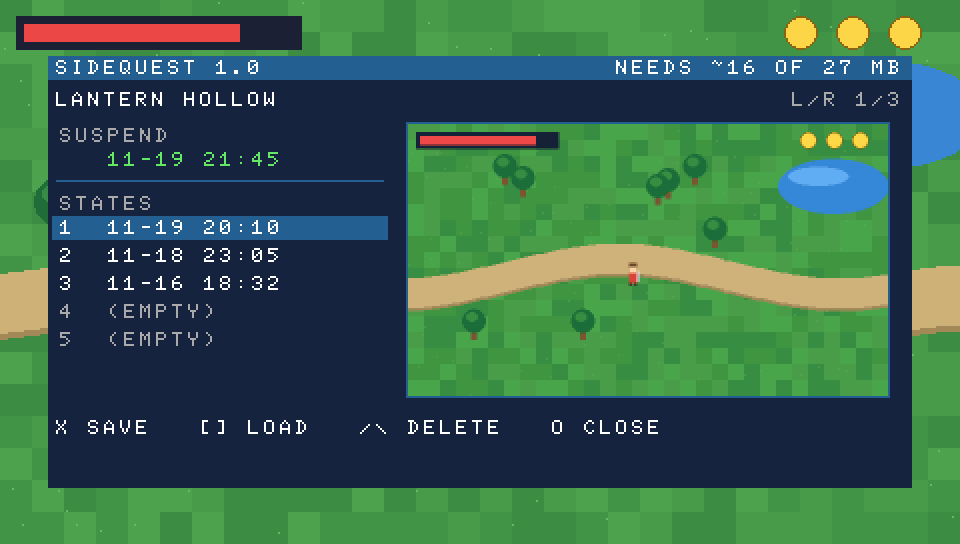
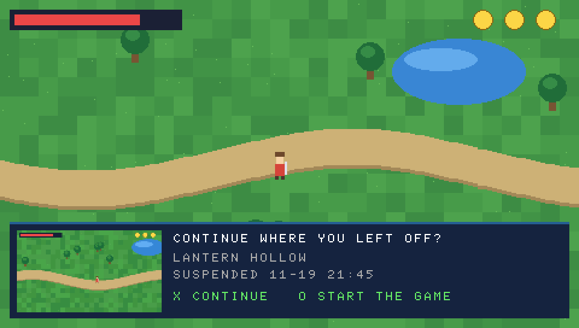
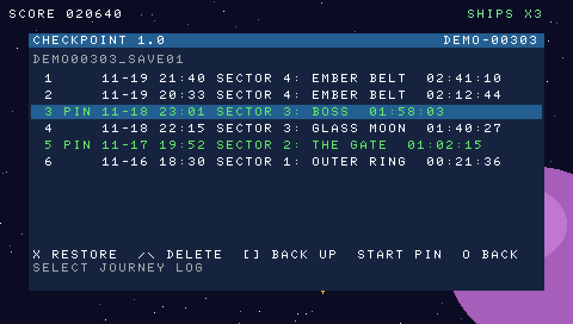
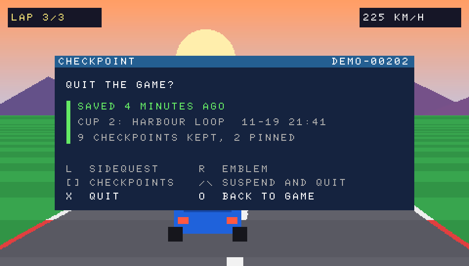
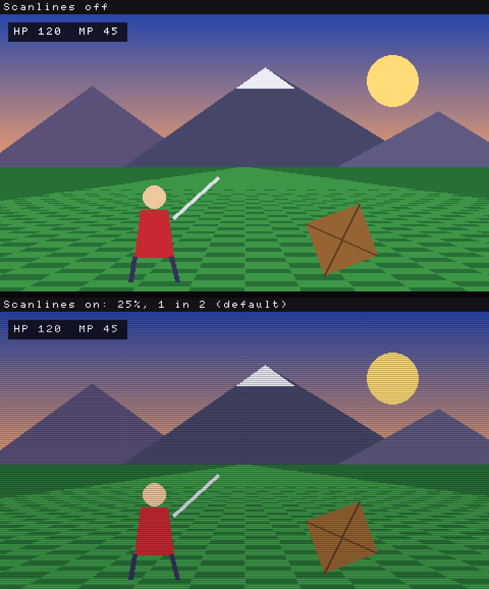
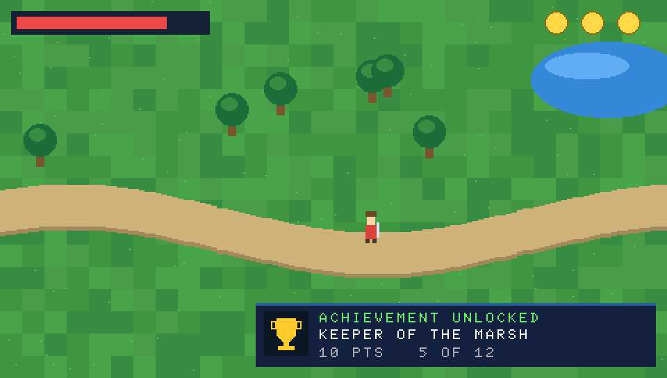
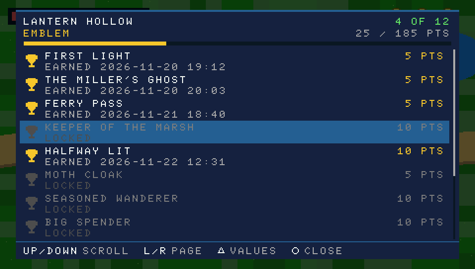

# PSP ARK Plugins

Four kernel plugins for PSP games on ARK-5 custom firmware: **Sidequest**, **Checkpoint**, **Scanline** and **Emblem**. They are independent of each other, so you can install any of them, and they are made to run side by side.

| Plugin | What it does | Opens with |
|---|---|---|
| [**Sidequest**](#sidequest) | Save states. Freezes the whole system and brings it back later: one suspend slot and five state slots for every game. | Hold **SELECT** alone, 1 s |
| [**Checkpoint**](#checkpoint) | A dated history of your game saves, a journey log that writes itself, and a PS-button quit screen that shows when you last saved. | **L + R + SELECT**, PS button |
| [**Scanline**](#scanline) | CRT-style scanlines over any game, with settings kept per game. | Hold **L + R** with a button, ½ s |
| [**Emblem**](#emblem) | Achievements, earned and kept on the Memory Stick. One text file per game. | Hold **L + R + LEFT**, ½ s |

All four are version 1.0 and come in one release file, `psp-ark-plugins-v1.0.zip`.

> **Disclosure.** These plugins were written by Claude, Anthropic’s AI model, from my ideas and my testing on a PSP-3000. I’m not a kernel programmer, and nothing has been tested beyond my own console. Please read the known issues ([Sidequest + Checkpoint](docs/sidequest-checkpoint-known-issues.md), [Scanline](docs/scanline-known-issues.md), [Emblem](docs/emblem-known-issues.md)) before relying on them.

## Sidequest + Checkpoint

Two plugins for PSP games on ARK-5 custom firmware to manage Save states and Save Files allowing quick resume of games and live backups of save files. They are released together and share one version number.

### Sidequest

Save states for PSP games. Sidequest freezes the whole system exactly as it is and brings it back later. Every game has six slots of its own: a suspend slot and five states, each with a picture.

| | |
|---|---|
|  |  |

- Hold SELECT on its own for one second to open the menu. X saves, □ loads, △ deletes.
- L / R looks at other games' slots, and loading one switches games.
- Starting a game that has a slot offers to continue from the newest one.
- The PSP sleeps for a few seconds for each save and load, and wakes itself.

**Requirements:** PSP-3000 (the PSP-2000 has the same memory and may work but is untested; not the 1000, Go or Street). ARK-5 with **Extra RAM** set to `Off`. Games started from an ISO/CSO or a PSN `EBOOT.PBP`; real UMD discs are refused. A slot takes about 5MB to 27MB of Memory Stick space.

**Documentation:** [Manual](docs/sidequest.md) · [Known issues and test status](docs/sidequest-checkpoint-known-issues.md) · [How it works](docs/sidequest-checkpoint-how-it-works.md)

### Checkpoint

A history of your game saves. Checkpoint keeps a dated copy every time a game saves, so an earlier version can be put back. It also keeps a journey log, a diary of the playthrough that writes itself, and replaces the PS-button quit screen with one that shows when you last saved.

| | |
|---|---|
|  |  |

- L + R + SELECT opens the menu: pick a save, pick a version, restore it. START pins a version so it is never pushed out.
- SELECT in the menu opens the journey log.
- The PS button opens the quit screen. From there, L opens Sidequest's menu, R opens Emblem's viewer, and △ is **suspend and quit**: the game is frozen into Sidequest's suspend slot and closed, and offers to continue from that moment the next time you start it.

**Requirements:** PSP-3000 on ARK-5. PSP games only, not PS1 games. Checkpoint uses up to ten times the size of each save (most saves are under 1MB).

**Documentation:** [Manual](docs/checkpoint.md) · [Known issues and test status](docs/sidequest-checkpoint-known-issues.md) · [How it works](docs/sidequest-checkpoint-how-it-works.md)

## Scanline

CRT-style scanlines over any game, with the settings you choose remembered for each game.



- Seven strengths from 12.5% to 100%, with lines on every 2nd, 3rd or 4th row.
- Changed from inside the game with L + R and one button. No menu.
- **Each game keeps its own settings**, including whether scanlines are on at all.
- Two modes per game: mode 1 (the default) for almost every game, mode 2 for a game whose top rows flicker.
- Costs about 3 ms a frame in a 16-bit game on a PSP-3000.

This is a new plugin written from scratch. It is not based on, and shares no code with, the older ScanLine 0.1 plugin by Omega2058.

**Requirements:** PSP-3000 on ARK-5. Other PSP models are untested, and PS1 games have not been tried.

**Documentation:** [Manual](docs/scanline.md) · [Known issues and test status](docs/scanline-known-issues.md) · [How it works](docs/scanline-how-it-works.md)

## Emblem

Achievements for PSP games, kept on the Memory Stick. Emblem watches a game's memory while you play and pops up a card when an achievement is earned. Nothing goes online.

| | |
|---|---|
|  |  |

- **One text file per game.** The plugin knows no games itself; a game without a file is left alone.
- **41 games, 1,731 achievements in this release**, every file written or checked by hand. Most files cover part of a game's set, and only Ys: The Oath in Felghana has been played on a PSP so far; see the [manual](docs/emblem.md#games) for the list.
- Hold L + R + LEFT for half a second to see every achievement of the game, earned or locked.
- Loading a save that is already far in catches up at once.

Achievement titles and points come from the [RetroAchievements](https://retroachievements.org) sets, and the memory addresses from their public code notes. Emblem is not connected to RetroAchievements, and nothing earned here appears on a RetroAchievements account.

**Requirements:** PSP-3000 on ARK-5. PSP games only. Your copy has to be the release a game file was made for.

**Documentation:** [Manual](docs/emblem.md) · [Adding a game](docs/emblem-adding-games.md) · [Known issues and test status](docs/emblem-known-issues.md) · [How it works](docs/emblem-how-it-works.md)

*The pictures on this page are drawn from the plugins' own layout, colours and font, or by their own code. The games behind them are stand-in scenes, not real games.*

## Install

Download `psp-ark-plugins-v1.0.zip` from the [Releases](../../releases) page and unpack it. Install all four, or only the ones you want.

1. Copy the `.prx` files you want from `SEPLUGINS` to `ms0:/SEPLUGINS/`.
2. Copy the matching folders (`SIDEQUEST`, `CHECKPOINT`, `SCANLINE`, `EMBLEM`) to the root of the Memory Stick. `EMBLEM` holds the game files, so Emblem needs it. The other three hold settings and are made by the plugins if missing.
3. Add a line to `ms0:/SEPLUGINS/PLUGINS.TXT` for each plugin you installed:
   ```
   game, ms0:/SEPLUGINS/sidequest.prx, on
   game, ms0:/SEPLUGINS/checkpoint.prx, on
   game, ms0:/SEPLUGINS/scanline.prx, on
   game, ms0:/SEPLUGINS/emblem.prx, on
   ```
4. Restart the PSP.

## Buttons at a glance

None of the four uses another's buttons, and all leave MissyHUD's L + R + START alone.

| Where | Button | Action |
|---|---|---|
| In a game | Hold SELECT alone, 1 s | Sidequest menu |
| In a game | L + R + SELECT | Checkpoint menu |
| In a game | PS button | Checkpoint's quit screen |
| In a game | Hold L + R + LEFT, ½ s | Emblem's achievement viewer |
| In a game | Hold L + R + △, ½ s | Scanlines on / off for this game |
| In a game | Hold L + R + UP / DOWN, ½ s | Darker / lighter scanlines |
| In a game | Hold L + R + O, ½ s | Scanline spacing: 1 in 2, 3 or 4 rows |
| In a game | Hold L + R + □, ½ s | Scanline mode 1 / mode 2 |
| Sidequest menu | X / □ / △ | Save state / load / delete |
| Sidequest menu | L / R | Look at another game's slots |
| Checkpoint menu | X / □ / △ / START | Open or restore / back up now / delete / pin |
| Checkpoint menu | SELECT | Journey log (L / R turn the page) |
| Quit screen | X / O | Quit / back to game |
| Quit screen | □ / △ | Checkpoints / suspend and quit |
| Quit screen | L / R | Sidequest menu / Emblem viewer |
| Emblem viewer | UP / DOWN, L / R, △ | Scroll, page, values page |

## If something goes wrong

- **Screen stays dark after a Sidequest save or load:** slide the POWER switch up. The save or load then finishes; nothing is lost.
- **Top rows or Scanline's label flicker in one game:** hold L + R + □ to try Scanline's mode 2 in that game.
- **An achievement pops when it should not:** delete its line from the game's file in `ms0:/EMBLEM/games/`, and from `ms0:/EMBLEM/earned/`.
- **PSP frozen:** hold the POWER switch up for 10 seconds to switch it off.
- **Turn a plugin off:** set its line in `PLUGINS.TXT` to `off`, or use ARK-5's plugin manager. Sidequest, Checkpoint and Emblem do not load in the XMB or in ARK's launcher, so those always stay usable. Scanlines can be turned off for a single game with L + R + △.
- **Logs:** `sidequest.log`, `checkpoint.log`, `scanline.log` and `emblem.log`, each in its plugin's folder on the Memory Stick. The first line of each run names the build (`built <date> <time>`); include it in any bug report.

## Repository layout

```
sidequest/    Sidequest source and tests
checkpoint/   Checkpoint source and tests
scanline/     Scanline source and tests
emblem/       Emblem source and tests, and the game files in emblem/games/
docs/         manuals, known issues and technical notes for each plugin; pictures in docs/images/
tools/        scripts that draw the pictures, and the Japanese font generator
```

The [changelog](CHANGELOG.md) covers all four.

## Building from source

Needs the [pspdev toolchain](https://github.com/pspdev/pspdev/releases/tag/latest).

```
export PSPDEV=/path/to/pspdev PATH=$PSPDEV/bin:$PATH
cd sidequest && make && sh tests/run_tests.sh
cd ../checkpoint && make && sh tests/run_tests.sh
cd ../scanline && make && sh tests/run_tests.sh && python3 tests/test_sim.py scanline.elf
cd ../emblem && make && bash tests/run_tests.sh
```

The tests run on a PC and need a C compiler. The emulator tests of Sidequest, Scanline and Emblem also need Python with `pip install unicorn pyelftools`; Emblem's is described in [emblem/README.md](emblem/README.md).

## Licence

MIT. See [LICENSE](LICENSE).

Checkpoint includes glyphs from Fusion Pixel Font (SIL Open Font License 1.1), whose Japanese glyphs are the Misaki font by Num Kadoma. See [LICENSE-FONT.txt](LICENSE-FONT.txt).
