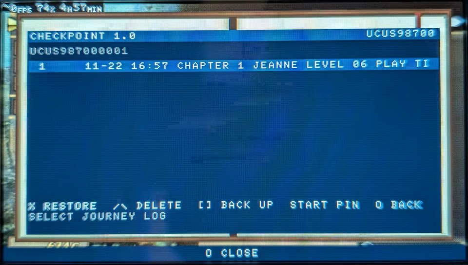
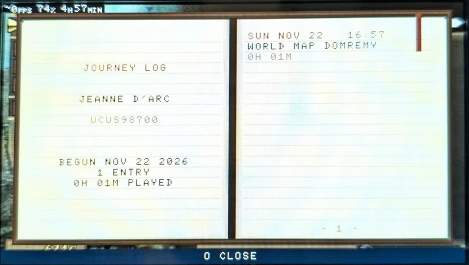
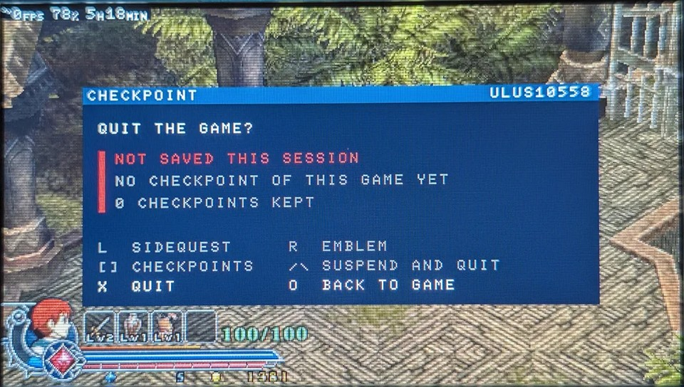

# Checkpoint 1.2 manual

**A history of your game saves.** Every time a PSP game saves, Checkpoint keeps a dated copy. If a save gets corrupted, you regret a choice, or you overwrote the wrong file, open the menu and put an earlier version back.

Checkpoint works on the game's own save data. It is separate from Sidequest's save states, and each plugin works without the other.

*The pictures are photos of a PSP-3000 screen.*

## Contents
- [How copies are made](#how-copies-are-made)
- [The menu](#the-menu)
- [Restoring a version](#restoring-a-version)
- [Pinning](#pinning)
- [The journey log](#the-journey-log)
- [Japanese text](#japanese-text)
- [The quit screen](#the-quit-screen)
- [Suspend and quit](#suspend-and-quit)
- [Where Checkpoint runs](#where-checkpoint-runs)
- [Files on the Memory Stick](#files-on-the-memory-stick)
- [Settings](#settings)
- [Messages](#messages)
- [Things to know](#things-to-know)

## How copies are made

- A few seconds after a game finishes saving, the save folder is copied to `ms0:/CHECKPOINT/<save folder>/<date_time>/`. The game is not paused for this.
- A game that writes more than one folder per save (for example a save and a system-data folder) gets a history for each.
- The last **10** versions of each save are kept. An older one is removed only after the new copy is safely written.
- A save identical to the newest kept version is not copied again.
- If a game saves again within **10 minutes**, the new copy replaces the newest version instead of adding one. Frequent autosaves therefore don't push out the whole history.
- At least 4MB is always left free on the Memory Stick. If there isn't room, the copy is skipped and the log says so.

## The menu

Press **L + R + SELECT** together. The game freezes and the menu opens at once. Any copy still waiting is made first.

The first screen lists the game's saves. Open one to see its versions, newest first. Each version shows its date and time and the description the game wrote into the save (chapter, level, play time: whatever the game shows on its own load screen).



| Button | Action |
|---|---|
| UP / DOWN | Pick a save, then a version |
| X | Open a save's versions / restore the selected version |
| □ | Back up the current save now |
| △ | Delete the selected version |
| START | Pin or unpin the selected version |
| SELECT | Open the journey log |
| O | Back / close |

**Sliding POWER while the menu, the journey log or the quit screen is open** closes it first, then the PSP sleeps as usual. On waking you are back in the game.

## Restoring a version

1. Open the save, pick a version, press X.
2. Confirm "Replace the game's current save with this version?".
3. Checkpoint first keeps a copy of the save as it is now, so the restore can itself be undone.
4. The version is written over the game's save.
5. **Load the save from the game's own load screen.** Until you do, the game still has its old progress in memory.

If anything fails partway, the game's current save is left exactly as it was. A restore is refused while the game is in the middle of saving.

## Pinning

Press START on a version to pin it. A pinned version is marked `PIN` and shown in green.

- It is never pushed out by newer saves.
- It is never replaced by a quick follow-up save.
- It stays until you unpin or delete it.

Up to 10 versions of each save can be pinned, on top of the 10 rolling ones.

## The journey log

A diary of the playthrough that writes itself. Each time the game saves with a new description (a new chapter, a new place), Checkpoint adds a line: the day and time, the game's own words, and how long you had played.

Press **SELECT** in the Checkpoint menu. The log opens as a two-page book over the frozen game, at the newest pages. **L** and **R** turn the page; **O** closes it.



- **The first page** shows the game, the day the log began, the number of entries and the total time played.
- **An entry is written only when the description changes.** Ten saves in the same place make one line. Going back to an earlier place makes a new line.
- **Numbers are ignored when comparing.** A higher level or a longer play time in the description does not make a new line; a new place or chapter does.
- **The text is the game's own.** A save has a title and a longer detail text. Checkpoint follows the title while it changes from save to save. When a game gives every save the same title ("Save data"), it follows the detail text instead. It does not know whether a text is a place, a chapter or a name.
- **Time played is counted by Checkpoint**, from the day the log begins, while the game is running. Time in menus, asleep, or before Checkpoint was installed is not counted, so it will not match the game's own clock.
- **Each save file is followed separately.** Two save files of the same game both appear in the one log.
- **System data is left out.** Many games write a small "system data" save a moment after the real one. Only the first save of such a burst gets a line. A game whose only save is its system data still gets its entry.
- **The log is a plain text file**, `ms0:/CHECKPOINT/JOURNEY/<game>.TXT`, one line per entry. You can read, edit or print it on a computer. Deleting it starts the diary again.
- The book shows the newest 120 entries; the text file keeps them all.
- **Japanese text is shown as Japanese**, in the book and in the menus, and is stored in the text file exactly as the game wrote it (UTF-8). See [Japanese text](#japanese-text).

`journey_detail = 1` makes the log follow the detail text only, for a game where the title changes in ways you do not care about. `journey = 0` turns the log off.

## Japanese text

Save descriptions and game titles written in Japanese are drawn in Japanese in the list of saves, the list of versions, the quit screen and the journey log.

- The font is an 8x8 pixel font: kana and about 6,500 kanji, the full Japanese standard set. Kana read easily. Kanji are small at this size; simple ones are clear, dense ones are recognisable more than readable.
- Every character takes the same width as an English letter, so lists stay lined up.
- Half-width kana are shown full width. Accented letters are shown without the accent (`é` as `E`).
- A character the font does not have (Korean, emoji) is shown as `?`.
- The journey log's text file always holds the exact text, whatever the screen can draw.

## The quit screen

Pressing the PS button opens Checkpoint's own "Quit the game?" screen in place of the system's. It shows when the game last saved and how many checkpoints you could go back to.

| Colour | Meaning |
|---|---|
| Green | Saved within the last 10 minutes |
| Amber | Saved longer ago than that |
| Red | Not saved since the game started |



| Button | Action |
|---|---|
| X | Quit the game, straight away |
| O | Back to the game |
| □ | Open the checkpoint menu |
| △ | Suspend and quit (needs Sidequest) |
| L | Open Sidequest's menu (needs Sidequest) |
| R | Open Emblem's achievement viewer (needs Emblem, and an achievement file for this game) |

- A button is only shown when it can be used. Without Sidequest and Emblem the screen has just the last two rows.

- L and R close the quit screen and hand over to the other plugin, which opens its own screen a moment later. The game runs for that moment.
- Any save still waiting to be copied is copied before the screen appears, so a checkpoint of your latest save exists before you quit.
- While the game is in the middle of saving, quitting is held back, and △, L and R are not offered.
- `quit_screen = 0` gives the system's own screen back. `warn_minutes` moves the green/amber line.

## Suspend and quit

With Sidequest installed, △ on the quit screen asks Sidequest to freeze the game into its suspend slot and then closes the game. The screen goes dark for a few seconds while the slot is taken.

The next time you start that game, Sidequest offers to continue from that moment. See the [Sidequest manual](sidequest.md#suspend-and-quit).

Without Sidequest the option is not offered.

## Where Checkpoint runs

PSP games only (ISO/CSO, PSN `EBOOT.PBP`, or disc). Not the XMB, not PS1 games, not ARK's launcher.

## Files on the Memory Stick

```
ms0:/SEPLUGINS/checkpoint.prx
ms0:/CHECKPOINT/config.txt
ms0:/CHECKPOINT/checkpoint.log
ms0:/CHECKPOINT/<save folder>/<YYYYMMDD_HHMMSS>/     one version: a plain copy of the save folder
ms0:/CHECKPOINT/<save folder>/<YYYYMMDD_HHMMSS>.PIN  marks that version as pinned
ms0:/CHECKPOINT/JOURNEY/<game>.TXT                   the journey log, one line per entry
ms0:/CHECKPOINT/JOURNEY/<game>.TIM                   seconds played, counted by Checkpoint
ms0:/CHECKPOINT/JOURNEY/<game>.KEY                   what each save last showed, for spotting changes
```

Versions are ordinary copies. You can copy one back to `ms0:/PSP/SAVEDATA/` by hand with a computer.

## Settings

`ms0:/CHECKPOINT/config.txt`. Lines starting with `#` are ignored. Changes take effect the next time a game starts.

| Key | Default | Meaning |
|---|---|---|
| `enabled` | `1` | `0` = no automatic copies. The menu still works. |
| `keep` | `10` | Versions kept for each save (1 to 30). |
| `min_minutes` | `10` | A new save replaces the newest version if that is younger than this. `0` = keep every save. |
| `hotkey` | `0x0301` | Buttons that open the menu, held together. SELECT `0x1`, START `0x8`, UP `0x10`, DOWN `0x40`, L `0x100`, R `0x200`, TRIANGLE `0x1000`, CIRCLE `0x2000`, CROSS `0x4000`, SQUARE `0x8000`. Add them up. |
| `hold_ms` | `100` | How long to hold them, in milliseconds (50 to 5000). |
| `quit_screen` | `1` | `0` = the PSP's own quit screen. |
| `warn_minutes` | `10` | On the quit screen, a save older than this is shown in amber. |
| `journey` | `1` | `0` = no journey log. |
| `journey_detail` | `0` | `0` = follow the title, or the detail when the title never changes. `1` = detail only. |

## Messages

| Message | Meaning |
|---|---|
| Backed up | □ made a new version of the current save. |
| Already backed up: nothing has changed | The current save is identical to the newest version. |
| The game has no save there right now | There is nothing in the game's save folder to back up. |
| Restored. Now load it from the game's load screen. | The version is in place; the game has not read it yet. |
| Could not keep the current save first. Nothing changed. | The safety copy failed (usually no space), so the restore was not attempted. |
| The game is saving. Close the menu and try again. | Restores are refused while a save is in progress. |
| 10 versions of this save are pinned already | Unpin one first. |

## Things to know

- Space used is up to 10 times the size of each save, plus pinned versions. Most saves are under 1MB.
- Only saves made through the PSP's normal save system are seen. That is nearly every game.
- The default menu buttons avoid MissyHUD (L + R + START) and Sidequest (SELECT alone).
- `checkpoint.log` records each copy and restore, and the build it was made with.
