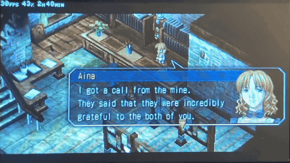
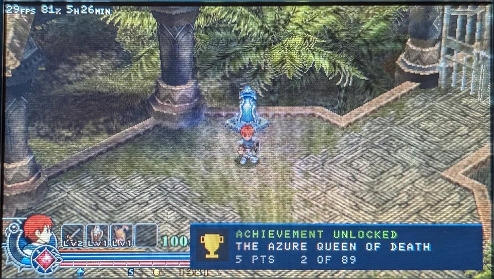
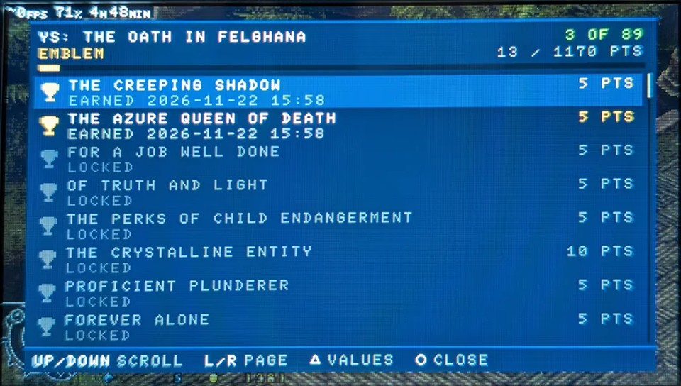

# Emblem 1.0 manual

**Achievements for PSP games, kept on the Memory Stick.** Emblem watches a game's memory while you play and pops up a card when an achievement is earned. What you earn is written to a plain text file on the Memory Stick. Nothing goes online.

Emblem itself knows no games. Each game is one text file in `ms0:/EMBLEM/games/`, and a game without a file is left alone.

*The pictures are photos and a video of a PSP-3000 screen.*

## Contents
- [What you see](#what-you-see)
- [The viewer](#the-viewer)
- [Loading a save that is already far in](#loading-a-save-that-is-already-far-in)
- [Games](#games)
- [Files on the Memory Stick](#files-on-the-memory-stick)
- [The log](#the-log)
- [Where Emblem runs](#where-emblem-runs)
- [Things to know](#things-to-know)

## What you see

When an achievement is earned, a card slides up in the bottom right corner, stays for 5 seconds and slides away. The game keeps running.

<p align="center">
  
  
</p>

- The last line gives the points and how many of the game's achievements you have.
- Several at once are shown one after another. Past eight, the rest are summed up on one "And N more" card.
- An achievement is earned once. It is written to the Memory Stick the moment it unlocks.

## The viewer

Hold **L + R + LEFT** for half a second. The game freezes and the list of the game's achievements opens. With Checkpoint installed, **R** on its quit screen (PS button) opens it too.



| Button | Action |
|---|---|
| UP / DOWN | Move one row. Keeps moving while held |
| L / R | Move a page of eight |
| △ | Values page / back to the list |
| O | Close |

- Earned achievements show a gold cup and the date. The others are grey and say `LOCKED`.
- The header shows how many you have, your points, and a bar.
- **The totals count only the achievements in the game's file**, not the full RetroAchievements set. A file that covers 28 of a game's 80 achievements shows "N of 28".
- The viewer does not open while another plugin's menu has the game frozen.
- Sliding POWER while the viewer is open closes it first; the PSP then sleeps as usual.

### The values page

△ shows what Emblem is reading from the game right now.

- **The values** are the ones the game's file asks to show, such as the level and the money. If they match what the game shows, the file fits your copy of the game.
- **Ready** says whether Emblem considers the game to be running. On a title screen or while loading it says `NOT NOW (TITLE SCREEN OR LOADING)`, and nothing can unlock.
- **File** and **Build** name the game file and the plugin build.

If nothing ever unlocks in a game, a photo of this page says why.

## Loading a save that is already far in

About a second after a save is loaded, Emblem looks at everything once. Achievements the save has already met are written down quietly and shown together on one card, "Already earned".

Some achievements are about a moment (winning a fight without being hit, buying something). Those cannot be told from a save and only unlock when they happen while you play.

## Games

This release has 42 files for 41 games, 1,731 achievements in all.

| Game | Game ID | In the file | In RA's set |
|---|---|---|---|
| Ys: The Oath in Felghana | `ULUS10558` | 89 | 95 |
| Valkyria Chronicles 2 | `ULUS10515` | 233 | 314 |
| .hack//Link | `ULJS00266` | 131 | 132 |
| Digimon World Re:Digitize | `NPJH50588` | 129 | 220 |
| Valkyrie Profile: Lenneth | `ULUS10107` | 79 | 161 |
| Tenchu: Shadow Assassins | `ULUS10419` | 74 | 94 |
| Sword Art Online: Infinity Moment | `NPJH50701` | 69 | 174 |
| 7th Dragon 2020 | `NPJH50459` | 62 | 80 |
| The Legend of Heroes: Trails in the Sky | `ULUS10540` | 57 | 150 |
| Disgaea: Afternoon of Darkness | `ULUS10308` | 56 | 82 |
| Sunday vs Magazine: Shuuketsu! Choujou Daikessen | `ULJM05450` | 54 | 110 |
| The Legend of Heroes: Trails in the Sky SC (disc 1) | `NPUH10191` | 54 | 245 |
| The Legend of Heroes: Trails in the Sky SC (disc 2) | `NPUH10197` | 54 | 245 |
| Jeanne d'Arc | `UCUS98700` | 47 | 90 |
| Shin Megami Tensei: Persona 3 Portable | `ULUS10512` | 42 | 139 |
| Soul Eater: Battle Resonance | `ULJS00176` | 40 | 40 |
| Disgaea 2: Dark Hero Days | `ULUS10461` | 34 | 103 |
| Mega Man: Maverick Hunter X | `ULUS10068` | 34 | 59 |
| Corpse Party | `NPUH10117` | 33 | 33 |
| Danganronpa: Kibou no Gakuen to Zetsubou no Koukousei | `NPJH50515` | 33 | 90 |
| Dissidia 012: Duodecim Final Fantasy | `ULES01505` | 31 | 195 |
| Corpse Party: Sweet Sachiko's Hysteric Birthday Bash | `ULJM06114` | 30 | 31 |
| Wild Arms XF | `ULUS10339` | 27 | 92 |
| Hexyz Force | `ULUS10506` | 24 | 151 |
| Fate/Extra | `ULUS10576` | 22 | 90 |
| Ys I & II Chronicles | `ULUS10547` | 21 | 182 |
| Ys vs. Sora no Kiseki: Alternative Saga | `NPJH50276` | 21 | 133 |
| Tetris | `NPUZ00003` | 20 | 36 |
| Crisis Core: Final Fantasy VII | `ULES01044` | 18 | 238 |
| Final Fantasy IV: The Complete Collection | `ULUS10560` | 18 | 306 |
| Fate/Extra CCC | `NPJH50505` | 16 | 101 |
| The Legend of Heroes: Zero no Kiseki | `NPJH50311` | 15 | 257 |
| Final Fantasy III | `NPUH10125` | 14 | 152 |
| Lunar: Silver Star Harmony | `ULUS10482` | 13 | 95 |
| The Legend of Heroes: Trails in the Sky the 3rd | `ULJM05353` | 9 | 151 |
| The Legend of Nayuta: Boundless Trails | `NPJH50625` | 9 | 249 |
| Final Fantasy Tactics: The War of the Lions | `ULUS10297` | 6 | 171 |
| The 3rd Birthday | `ULUS10567` | 4 | 74 |
| Ys Seven | `ULUS10551` | 4 | 202 |
| Mega Man: Powered Up | `ULUS10091` | 3 | 143 |
| Kingdom Hearts: Birth by Sleep -Final Mix- | `ULJM05775` | 1 | 131 |
| Star Ocean: First Departure | `ULUS10374` | 1 | 115 |

- **Every file was written or checked by hand, with AI assistance,** from RetroAchievements' public memory notes. Only Ys: The Oath in Felghana has been played on a PSP; the others have been checked on a PC only. If an achievement pops when it should not, delete its line from the file.
- **Most files cover part of a set.** A file holds only what the notes show plainly: story progress, quests, bosses, collections, levels. Challenges such as "without taking damage" or "in under a minute" are mostly left out. The first lines of each file list what is not there, and the viewer's totals count only what the file offers.
- **Trails in the Sky SC** has one file for each disc, with the same achievements.
- **Your copy has to be the release the file was made for.** The file name is the game ID. Emblem's log gives the ID of the game you started (see [The log](#the-log)). A fan translation or an undub usually keeps the ID but can move things in memory; a file can then stay silent or misfire.

To write or extend a file, see [Adding a game](emblem-adding-games.md).

## Files on the Memory Stick

```
ms0:/SEPLUGINS/emblem.prx
ms0:/EMBLEM/games/<GAME ID>.txt     what to watch, one file per game
ms0:/EMBLEM/earned/<GAME ID>.txt    what you have earned
ms0:/EMBLEM/emblem.log
```

The earned file is plain text, one line per achievement:

```
# Achievements earned in Ys: The Oath in Felghana (ULUS10558), kept by Emblem
47 | 2026-11-22 12:31 | Getting to Know You | 3 pts
```

- To take an achievement back, delete its line. To start a game over, delete the file.
- Back the `earned` folder up with your saves.

## The log

`emblem.log` starts each run with `Emblem 1.0 (built <date> <time>) start: game '<GAME ID>'`. After that:

- whether a file for the game was found, how many achievements it has, and any line of it that could not be read, with its line number;
- how many achievements were already earned;
- every unlock, with the time.

Past 16KB the old log becomes `emblem.old`.

## Where Emblem runs

In PSP games started from an ISO/CSO or an `EBOOT.PBP`. Not in the XMB, not in ARK's launcher, not in PS1 games. In a game with no file it switches itself off about 4 seconds after the game starts.

## Things to know

- **Sidequest states.** Loading an older state does not take achievements away: the earned file on the Memory Stick is what counts, and Emblem reads it again before writing.
- **A save state can earn things early.** Achievements follow the game's memory. Load a state from late in the game and its achievements unlock.
- **Achievement titles and points** come from the [RetroAchievements](https://retroachievements.org) set for each game. Emblem is not connected to RetroAchievements and sends nothing to it; nothing earned here appears on a RetroAchievements account.
- **Buttons used by the other plugins are left alone:** Scanline (L + R with △ ○ □ UP DOWN), MissyHUD (L + R + START), Checkpoint (L + R + SELECT), Sidequest (SELECT alone).
