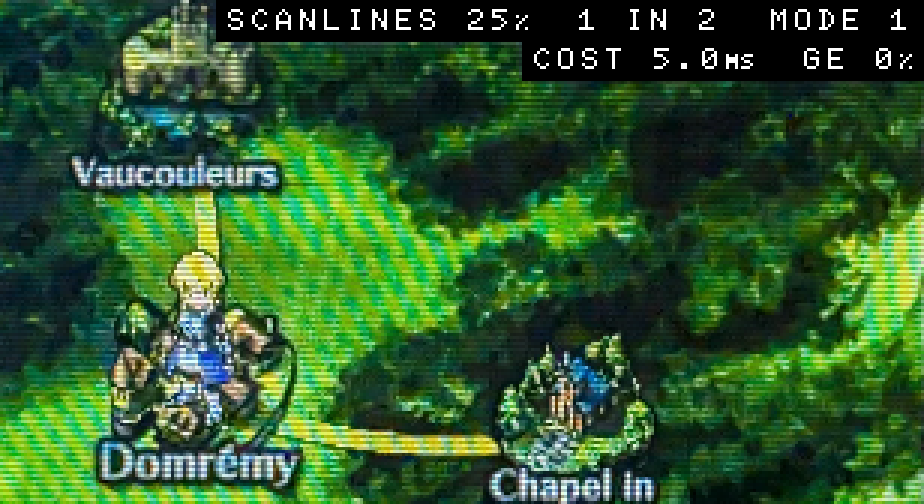
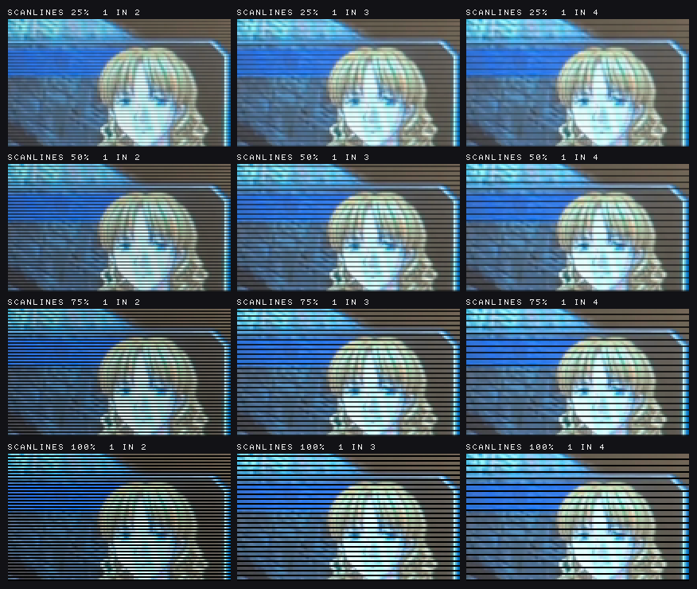

# Scanline 1.0 manual

**CRT-style scanlines over PSP games.** As each frame is shown, Scanline darkens every 2nd, 3rd or 4th row of it. The game itself is not changed and does not know.

*The pictures are a photo and a video frame of a PSP-3000 screen, rebuilt at the PSP's own pixel size, with the lines and the label drawn by the plugin's code.*

## Contents
- [Buttons](#buttons)
- [The label](#the-label)
- [Strength](#strength)
- [Spacing](#spacing)
- [Mode 1 and mode 2](#mode-1-and-mode-2)
- [Jagged edges](#jagged-edges)
- [Each game keeps its own settings](#each-game-keeps-its-own-settings)
- [Starting settings](#starting-settings)
- [Files on the Memory Stick](#files-on-the-memory-stick)
- [The log](#the-log)
- [Things to know](#things-to-know)

## Buttons

Hold **L + R** together with exactly one of these for **half a second**:

| Button | Action |
|---|---|
| △ | Scanlines on / off for this game |
| UP | Darker lines, one step. Keeps stepping while held |
| DOWN | Lighter lines, one step. Keeps stepping while held |
| O | Spacing: 1 in 2 rows, then 1 in 3, then 1 in 4, then back |
| □ | Mode 1 / mode 2 |

- A quick tap does nothing. Only a deliberate hold counts, so a game that has you hold both shoulder buttons and tap a face button does not change your scanlines.
- Changing strength, spacing or mode also turns scanlines on.
- The game sees these presses too.
- `hotkeys = 0` in the settings file switches the buttons off once you have what you like.

Buttons used by other plugins are left alone: MissyHUD (L + R + START), Checkpoint (L + R + SELECT), Sidequest (SELECT alone).

## The label

After every change a label shows in the top right corner for about 3 seconds. The units (`%` and `MS`) are drawn small after their numbers.



- **First line:** strength, spacing and mode. Or `SCANLINES OFF FOR THIS GAME`.
- **`COST x.xMS`:** the time the scanlines take per frame in this game, averaged over the last 64 frames. It shows `COST ...` until 64 frames have been counted. A 30 fps game has 33 ms per frame and a 60 fps game 16.7 ms.
- **`GE n%`:** of the times in the last 64 frames that Scanline asked the graphics chip, how often it was still drawing the frame the game had just handed over. In most games this is 0. Above 0, Scanline had to wait for the chip before drawing its lines; if a game with a high figure shows flickering lines or slows down, that is why.
- **`WAIT x.xMS`:** shown only when `GE` is above 0: the time per frame Scanline spent waiting for the graphics chip, on top of `COST`.
- **`GE --`:** the chip is not asked in this game, because the game changes its picture from inside an interrupt and the chip has moved on to the next frame by then.
- **`GE ERR`** or **`GE N/A`:** the question could not be asked (the system call failed, or was not found on this PSP). Scanlines still work; please report it.

## Strength

How dark each scanline is. Seven steps:

| Step | Shown as | In `config.txt` |
|---|---|---|
| 12.5% | `12.5%` | `13` |
| 25% (default) | `25%` | `25` |
| 37.5% | `37.5%` | `38` |
| 50% | `50%` | `50` |
| 62.5% | `62.5%` | `63` |
| 75% | `75%` | `75` |
| 100% (black lines) | `100%` | `100` |



The picture gets darker overall as the lines do: at 50% on every 2nd row about a quarter of the brightness is lost, at 25% about an eighth. Raise the PSP's brightness a notch to make up for it.

12.5% is the lightest step because of how the lines are made. A PSP colour has 32 levels, and a step lighter than an eighth would leave the darker half of them unchanged.

## Spacing

One dark row in every 2, 3 or 4.

1 in 2 is the classic look. 1 in 3 and 1 in 4 are thinner and keep more brightness.

## Mode 1 and mode 2

The two modes differ in *when* the lines are drawn. Each game remembers its own.

| | Mode 1 (default) | Mode 2 |
|---|---|---|
| Order | The game changes its picture, then the lines are drawn straight after | The lines are drawn, then the game's picture change goes through |
| Good for | Almost every game | A game whose top few rows, or the label's top line, flicker or lose their lines in mode 1 |
| Can cause | Top rows without lines in a game that is heavy to draw and changes its picture late | Tearing in a game that changes its picture immediately; sound popping in a game that changes it from inside an interrupt |

Stay in mode 1 unless you see the top of the screen flicker. If you do, hold L + R + □ in that game and keep whichever mode looks and sounds better there. In many games the two look the same.

## Jagged edges

Scanlines break up the stair steps on edges that are close to horizontal, so they are less noticeable. The stronger the lines, the more they do.

This is not real anti-aliasing: stair steps on steep edges stay as they are.

## Each game keeps its own settings

On or off, strength, spacing and mode are remembered for each game separately. About 3 seconds after your last change in a game, its settings are written to `ms0:/SCANLINE/games.txt`, one line a game:

```
YS___THE_OATH_IN_FELGHANA_3F2A = 1 25 2 1
```

That is the name, then on (1) or off (0), strength, spacing, mode.

- The name is made from the game's ISO file name, or for an `EBOOT.PBP` from its folder, plus four characters that identify the full path.
- **Renaming or moving a game's file makes it a new game** to the plugin. It starts again from the starting settings.
- A game you have never changed anything in uses the starting settings below.
- ARK's launcher counts as a game of its own.
- To make a game forget its settings, delete its line. The file can be edited on a computer.
- The file holds about 200 games. Past that, the oldest lines are dropped first.

## Starting settings

`ms0:/SCANLINE/config.txt` holds what a game gets the first time, and a few things that are the same for every game. The buttons never change this file; edit it on a computer. Lines starting with `#` are ignored. Changes take effect the next time a game starts.

| Key | Default | Meaning |
|---|---|---|
| `enabled` | `1` | `0` = a new game starts with scanlines off |
| `strength` | `25` | Percent. Rounded to the nearest step |
| `spacing` | `2` | One dark row every 2, 3 or 4 rows |
| `mode` | `1` | `1` or `2`. See [Mode 1 and mode 2](#mode-1-and-mode-2) |
| `hotkeys` | `1` | `0` = the L + R buttons do nothing |
| `defer` | `1` | `1` = in games that change the picture from inside an interrupt, the lines are drawn by the plugin's own thread just after. `0` = drawn inside the interrupt, which makes the sound pop in those games |
| `ge_wait` | `1` | `1` = if the graphics chip is still drawing a frame when the game hands it over, wait for it (12 ms at most). `0` = never wait; the lines can flicker in such games |
| `fast` | `1` | `0` = a slower way of reading the screen, kept for comparing times |

The last three are there for testing. Leave them at `1`.


## Files on the Memory Stick

```
ms0:/SEPLUGINS/scanline.prx
ms0:/SCANLINE/config.txt      starting settings
ms0:/SCANLINE/games.txt       each game's own settings
ms0:/SCANLINE/scanline.log    what the plugin found and how long it takes
```

## The log

`scanline.log` starts each run with `Scanline 1.0 (built <date> <time>) start`. After that:

- `hook: ...` how the plugin attached itself to the display.
- `game '...'` the name it gave the game and whether the game had settings of its own.
- `first frame: address, format, stride`.
- After 600 and after 6000 frames: the average and worst time per frame, how many frames came from an interrupt or were changed immediately, and how often the graphics chip was still drawing.

The log is kept short: past 3KB the old one becomes `scanline.old`.

## Things to know

- **The picture gets darker.** That is what scanlines are. Use a lighter step, wider spacing, or more screen brightness.
- **A few games get no scanlines** because they never hand frames over in the usual way. See [Known issues](scanline-known-issues.md).
- **Screens drawn by other plugins** (Sidequest's and Checkpoint's menus, the PS button screen) are not given lines. The frozen game picture behind them keeps the ones it had.
- **Sidequest states** bring back the Scanline settings that were in memory when the state was saved, until your next change.
- **32-bit games cost more** than 16-bit ones, about three times. Most PSP games are 16-bit.
