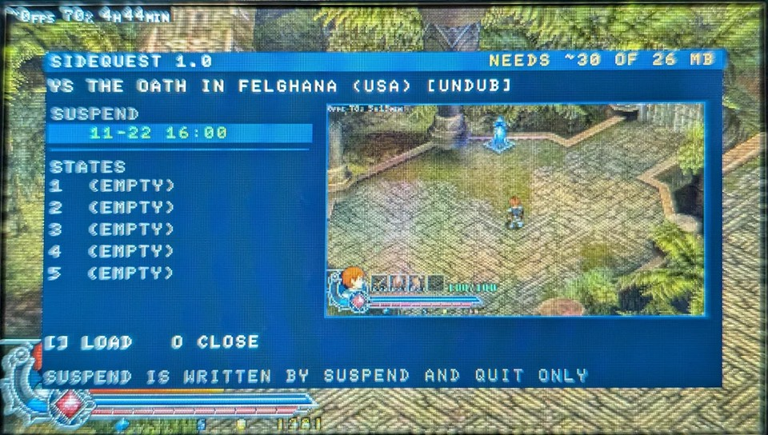
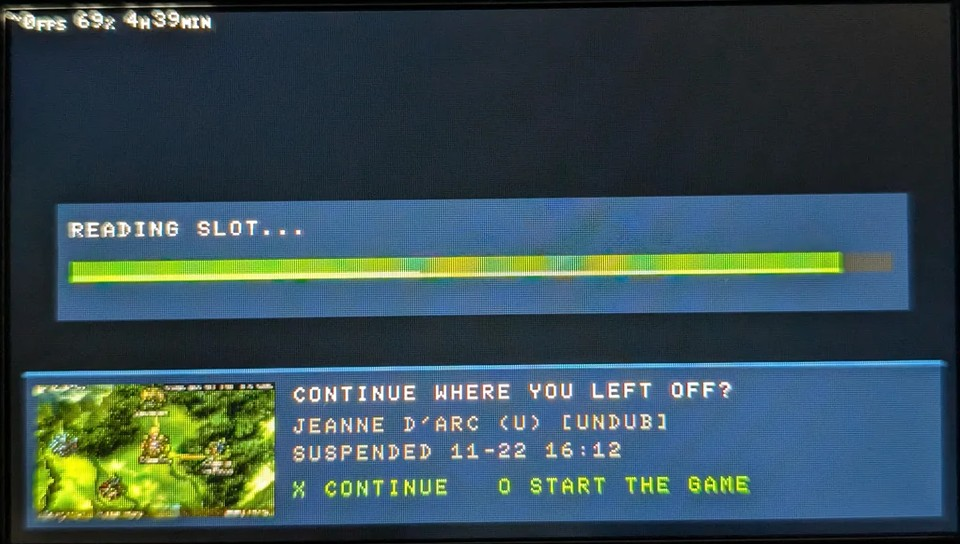

# Sidequest 1.3 manual

**Save states for PSP games.** Sidequest freezes the whole system exactly as it is (the game, its memory, the screen) into a slot on the Memory Stick, and can put that moment back later. Every game gets its own six slots.

Sidequest behaves like an emulator save state, not like a game save. It does not replace saving in the game.

*The pictures are photos of a PSP-3000 screen.*

## Contents
- [Opening the menu](#opening-the-menu)
- [The six slots](#the-six-slots)
- [Saving a state](#saving-a-state)
- [Loading](#loading)
- [Other games (L / R)](#other-games-l--r)
- [Suspend and quit](#suspend-and-quit)
- [Continue prompt](#continue-prompt)
- [What happens during a save or load](#what-happens-during-a-save-or-load)
- [After a load: mute and brightness](#after-a-load-mute-and-brightness)
- [After a load: the internal flash](#after-a-load-the-internal-flash)
- [Battery](#battery)
- [Where Sidequest runs](#where-sidequest-runs)
- [Files on the Memory Stick](#files-on-the-memory-stick)
- [Settings](#settings)
- [Messages](#messages)
- [Things to know](#things-to-know)

## Opening the menu

Hold **SELECT** on its own for about one second. It only triggers when nothing else is held. The game freezes and the menu opens, showing the slots of the game you are playing and a picture of the selected slot.

The game also sees that SELECT press. If that is a problem in a particular game, change the button in `config.txt`.



| Button | Action |
|---|---|
| UP / DOWN | Pick a slot |
| X | Save the game into the selected state |
| □ | Load the selected slot |
| △ | Delete the selected slot (a state or the suspend) |
| L / R | Look at another game's slots |
| O | Close the menu |

The PS button does nothing while the menu is open.

With Checkpoint installed, **L** on its quit screen (PS button) opens this menu too.

**Sliding POWER while the menu is open** closes the menu first, then the PSP sleeps as usual. On waking you are back in the game. The same goes for the continue prompt, which comes back after waking. Holding POWER up to switch off works the same way.

The title bar shows the version. The exact build (`built <date> <time>`) is the first line of each run in `sidequest.log`.

## The six slots

- **Suspend**, at the top, set apart from the rest. It is written only by "suspend and quit" and is replaced every time you suspend. You can load it. You cannot save to it by hand and you cannot delete it. It stays after you continue from it.
- **States 1 to 5.** You save, overwrite and delete these. They never clear themselves.

The buttons at the bottom change with the row: the suspend slot can only be loaded, and an empty state can only be saved to.

Each row shows the date and time it was saved. The selected slot's picture is the game screen at the moment the menu was opened for that save.

There is no limit on the number of games. The only limit is Memory Stick space.

## Saving a state

1. Open the menu, pick a state row, press X.
2. If the state is in use you are asked "Overwrite this slot?".
3. The screen goes dark for a few seconds and comes back by itself.
4. The state is written to the Memory Stick and the menu shows it.

Before anything happens Sidequest checks that the Memory Stick has room and that the game fits. If not, the save is refused and nothing changes.

A state takes about 5MB to 27MB, depending on how much memory the game uses.

## Loading

Pick a slot and press □. You are asked "Load this state?". The screen goes dark for a few seconds, comes back, and the game continues from the saved moment.

Everything since that moment is gone from memory, as with any save state. Game saves on the Memory Stick are not touched by a load.

Before a load Sidequest checks the slot file is undamaged, was made on this PSP with this firmware and ARK version, and that the game's ISO or EBOOT is still where it was. If any check fails, nothing is loaded and the running game carries on.

## Other games (L / R)

L and R step through the other games that have slots. The title turns amber and shows which page you are on.

On another game's page you can:
- **load** a slot, which switches straight to that game ("Switch games?");
- **delete** its states.

You cannot save there. A game can only be saved while it is the one running.

## Suspend and quit

Needs Checkpoint installed. Press the PS button to open Checkpoint's quit screen, then press △.

Sidequest saves the game into its suspend slot (the screen goes dark for a few seconds), then the game closes as it would from the normal quit screen.

The suspend slot is overwritten each time. It is not removed when you continue from it.

## Continue prompt

When you start a game that has any slot, the game pauses a few seconds in and asks **"Continue where you left off?"**, showing the picture of the most recent slot, whether that is the suspend slot or a state.



**From a launcher.** A launcher can skip the question. If `ms0:/SIDEQUEST/RESUME.REQ` holds the path of the game being started (the ISO, or the `EBOOT.PBP`) on one line, Sidequest loads the newest slot without asking and removes the file. This works even with `resume_prompt = 0`. The [Shelf launcher](https://github.com/00KAM1/psp-shelf-launcher) writes the file for games started from its Home tab. The game still starts first, and the state loads a few seconds in.

A launcher can also name the slot, or ask for none. `ms0:/SIDEQUEST/START.REQ` holds the game's path on the first line and, on the second, a slot number (0 for the suspend, 1 to 5 for the states) or the word `none`, which starts the game without loading and without the question. An empty slot gets the question instead. Shelf's "Start from..." writes this file.

- **X** goes straight back to that moment (a normal load: dark screen for a few seconds).
- **O** starts the game normally.

The game stays frozen until you answer. Turn the prompt off with `resume_prompt = 0`.

## What happens during a save or load

A PSP can only be captured or swapped at one safe point: the instant it wakes from sleep, when every part of the system has written its state into memory. So for each save and each load Sidequest puts the PSP to sleep.

It then wakes it again by itself. Just before the sleep Sidequest sets the PSP's clock alarm for 3 seconds ahead. You see the screen go dark, then come back, and the save or load finishes. The alarm is cancelled again as soon as the PSP is awake, so your own POWER-switch sleeps are not affected.

- If the screen ever stays dark, slide the POWER switch up. The save or load finishes as normal.
- `wake_seconds` changes the delay (2 to 30). If a game is slow to go to sleep and the screen sometimes stays dark, try 4 or 5.
- `wake_seconds = 0` turns the alarm off. The PSP then sleeps until you slide POWER.

The 3 seconds only covers the PSP going to sleep. The snapshot is taken on waking and written to the Memory Stick afterwards, so a large or slow save cannot be cut short by the alarm.

## After a load: mute and brightness

After every load the PSP is muted and the screen is set to 50% brightness, whatever the slot was saved with. This is so a loaded state never comes back at full volume.

- `load_mute = 0` keeps the sound setting the slot had.
- `load_brightness` sets a different percentage; `0` keeps what the slot had.

## After a load: the internal flash

A loaded state has the PSP read its internal flash again before the game continues. This adds about one second to every load. Without it, text drawn with the PSP's own fonts disappeared after a load and the PSP's settings could be lost; see [how it works](sidequest-checkpoint-how-it-works.md#the-internal-flash-after-a-load).

- It works on firmware 6.61 only. On any other firmware Sidequest refuses to save.
- States saved before 1.1 show as empty and cannot be loaded.

## Battery

Saving and loading are refused when the battery is at 5% or less and the charger is not connected. A PSP that loses power in the middle of a save or load could damage the slot or the internal flash. `min_battery` changes the limit (0 to 50); `0` turns the check off.

## Where Sidequest runs

Sidequest only loads inside PSP games started from an ISO/CSO or an `EBOOT.PBP`. It removes itself everywhere else:

- **XMB and ARK's custom launcher:** never loaded. Loading a slot from a launcher would cut the launcher off mid-run and it then starts in safe mode.
- **PS1 games:** not supported.
- **UMD discs:** refused.

`PLUGINS.TXT` still uses the `game` line; the plugin decides for itself.

## Files on the Memory Stick

```
ms0:/SEPLUGINS/sidequest.prx
ms0:/SIDEQUEST/config.txt
ms0:/SIDEQUEST/sidequest.log
ms0:/SIDEQUEST/<game>/SUSPEND.SQS   + SUSPEND.THM
ms0:/SIDEQUEST/<game>/STATE1.SQS    + STATE1.THM
...
ms0:/SIDEQUEST/<game>/STATE5.SQS    + STATE5.THM
```

- `<game>` is made from the ISO's file name (or the EBOOT's folder name), in capitals, plus four characters that identify the full path. For example, an ISO called `Ys Oath.iso` gets a folder like `YS_OATH_3A7C`.
- `.SQS` is the slot. `.THM` is its picture (240x136, 64KB).
- A slot is written to a temporary file first and only then given its final name, with the previous slot kept until that is done. A failed write leaves the old slot in place.
- To remove all of a game's slots, delete its folder with a computer.

## Settings

`ms0:/SIDEQUEST/config.txt`. Lines starting with `#` are ignored. Changes take effect the next time a game starts.

| Key | Default | Meaning |
|---|---|---|
| `hotkey` | `0x0001` | Button that opens the menu, held on its own. SELECT `0x1`, START `0x8`, UP `0x10`, DOWN `0x40`, L `0x100`, R `0x200`, TRIANGLE `0x1000`, CIRCLE `0x2000`, CROSS `0x4000`, SQUARE `0x8000`. Add numbers for a combination. |
| `hold_ms` | `1000` | How long to hold it, in milliseconds (100 to 5000). |
| `enable_load` | `1` | `0` = saving only; loads are refused. |
| `resume_prompt` | `1` | `0` = never ask to continue when a game starts. |
| `load_mute` | `1` | `1` = mute after every load. `0` = keep what the slot had. |
| `load_brightness` | `50` | Brightness in percent after every load (1 to 100). `0` = keep what the slot had. |
| `wake_seconds` | `3` | Seconds until the PSP wakes itself after sleeping for a save or load (2 to 30). `0` = no alarm; slide POWER. |
| `min_battery` | `5` | No save or load at or below this battery percentage without the charger (0 to 50). `0` = no limit. |

## Messages

| Message | Meaning |
|---|---|
| Not enough free space on the Memory Stick | The save was refused before anything happened. Free some space. |
| Slot is too big for this PSP | The game uses too much memory to fit in the work area. Nothing was changed. |
| UMD discs are not supported, only ISO/PSN | The game was started from a disc. |
| That game's file was moved or deleted | The ISO or EBOOT the slot belongs to is no longer at the same path. |
| Start that game to save it | You pressed X on another game's page. |
| Suspend is written by Suspend and Quit only | You pressed X on the suspend row. |
| A plugin is still writing: try again shortly | Another plugin (Checkpoint, Emblem, Scanline or Runtime) was in the middle of a write for ten seconds. Nothing was saved or loaded. Close the menu and try again. |
| Slot data is damaged. Not loaded. | The file failed its checks. The running game is untouched. |
| The PSP did not suspend (game busy?) | The game would not let the PSP sleep. Try again at a calmer moment (not during a load or a save). |
| Memory Stick was not refreshed! | After a load Sidequest could not confirm the Memory Stick was re-read. Saving in the game now could damage files; quit and restart the game to be safe. |
| Battery too low: connect the charger first | The battery is at or below `min_battery` and the charger is not connected. Nothing was done. |
| This firmware is not supported: nothing saved | The PSP's flash driver is not the one Sidequest knows (firmware 6.61). Saving is off; nothing was changed. |
| The internal flash could not be re-scanned. | Shown after a load. Text will be missing in this session. Press X to go on, then power the PSP off fully (hold POWER until the light goes out). |
| Power the PSP off fully before saving again | A load in this session could not re-scan the flash. Saving stays off until a full power-off. |

## Things to know

- **A load can undo progress.** If you load an old state and then save in the game, the game save now holds the old progress.
- **A slot only loads on the same PSP, firmware and ARK version** it was made on, and Sidequest only saves on firmware 6.61.
- **Delete every slot before you install or update Sidequest, another plugin, a launcher such as the [Shelf launcher](https://github.com/00KAM1/psp-shelf-launcher), or ARK.** A slot holds the whole system: the launcher and every plugin, in the versions installed when it was saved. Loading a slot from before an install or update, from this menu or by resuming a game from a launcher, can end in a black screen when you quit (hold POWER up for ten seconds to switch off), can run the old plugin versions or run without a plugin added since until the game is restarted, and can leave files on the Memory Stick damaged. On my PSP, the Shelf launcher's saved game list and logs were damaged after loading such a slot. Save in the game's own save menu first; delete every slot with △ in the menu (the suspend too; L / R shows your other games), or the game folders inside `ms0:/SIDEQUEST/` with a computer (keep `config.txt`); install; then take new states.
- **Don't move or rename a game's ISO** while it has slots. The slots are tied to its path.
- **Don't save a state during online or ad hoc play.**
- **States saved before 1.1 cannot be loaded.** They show as empty. Save into the slot again.
- After loading a slot, avoid changing system settings from inside that game.
- After a load the game is held frozen until the Memory Stick has been re-read, so the restored system does not write with an out-of-date picture of the files.
